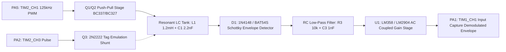

# 📐 Hardware & Electrical Engineering Guide: DIY Flipper Zero (OLED Edition)

**Target MCU**: STM32WB55CGU6 (UFQFPN48 package)  
**Maintainer**: [**AJ_60**](https://github.com/AJ60)  
**Repository**: [https://github.com/AJ60/Flipper_OLED_PCF8574_PN532](https://github.com/AJ60/Flipper_OLED_PCF8574_PN532)  
**Notice**: ⚖️ *Strictly for educational and academic engineering research purposes only.*

> [!WARNING]
> 🚧 **125 kHz LF-RFID Analog Hardware Status**:
> The discrete analog front-end for 125 kHz LF-RFID is **under active development / experimental**. Signal demodulation and card emulation reliability depend heavily on coil inductance tolerances, antenna tuning, and diode forward voltage thresholds. It may contain bugs or require component tuning on custom breadboards.

---

## 1. Complete Pinout & Bus Mapping Matrix

```mermaid
graph LR
    subgraph STM32WB55 [WeAct STM32WB55CGU6 MCU]
        PA0[PA0 - IR Receiver RX]
        PA1[PA1 - LF-RFID RX / CC1101 Internal GDO0]
        PA2[PA2 - LF-RFID Emulate / PN532 IRQ]
        PA3[PA3 - 1-Wire iButton Probe]
        PA4[PA4 - External SPI1 CS / CSN]
        PA5["PA5 (Header C3 / A5) - E07 TXEN / LF-RFID 125kHz TX"]
        PA6[PA6 - SPI1 Shared MISO]
        PA7["PA7 (Header C0) - I2C3 PN532 SCL"]
        PA8[PA8 - IR Transmitter TX]
        PA9[PA9 - I2C1 Shared SCL]
        PA10[PA10 - MicroSD Card SPI CS]
        PA15[PA15 - Internal CC1101 Radio SPI CS]
        PB0[PB0 - PCF8574 Keypad Ext INT]
        PB1[PB1 - INA219/226 Power ALERT]
        PB2["PB2 (Header B2) - Ext CC1101 GDO0 / NRF24 CE"]
        PB3[PB3 - SPI1 Shared SCK]
        PB4["PB4 (Header C1) - I2C3 PN532 SDA"]
        PB5["PB5 (Header A7) - SPI1 Shared MOSI"]
        PB8[PB8 - Piezo Speaker Buzzer]
        PB9[PB9 - I2C1 Shared SDA]
    end
```



---

## 2. Flipper-Compatible 18-Pin Expansion Header

The DIY Flipper Zero maps the official Flipper Zero 18-pin expansion header onto the WeAct STM32WB55CGU6 development board:

| Flipper Pin # | Flipper Label | Actual MCU Pin | WeAct Board Silkscreen Label | Direction | Primary Function & Peripherals |
|:---:|:---:|:---:|:---:|:---:|---|
| **1** | **5V** | `5V` (VBUS/Boost) | **`5V`** | Power OUT/IN | 5.0V DC regulated rail (from USB-C or 5V boost converter) |
| **2** | **A7** | `PB5` | **`A7`** (MCU PB5) | Output | **SPI1 MOSI** (Shared high-speed bus data output) |
| **3** | **A6** | `PA6` | **`A6`** | Input | **SPI1 MISO** (Shared high-speed bus data input) |
| **4** | **A4** | `PA4` | **`A4`** | Output | **External SPI1 CS / CSN** (Active-Low chip select) |
| **5** | **B3** | `PB3` | **`B3`** | Output | **SPI1 SCK** (Shared high-speed SPI clock, up to 32 MHz) |
| **6** | **B2** | `PB2` | **`B2`** | In / Out | **Ext CC1101 GDO0 IRQ** / **NRF24 CE** / General GPIO |
| **7** | **C3** | `PA5` | **`C3`** (Board `A5`) | Output | **E07 CC1101 TXEN** / LF-RFID 125 kHz Carrier PWM |
| **8** | **GND** | `GND` | **`G` / `GND`** | Ground | Common system ground reference |
| **9** | **3V3** | `3.3V` | **`3V3`** | Power OUT | 3.3V DC regulated rail (from onboard LDO) |
| **10** | **SWC** | `PA14` | **`SWC`** | Input | SWD Hardware Clock (for ST-Link debugging) |
| **11** | **GND** | `GND` | **`G` / `GND`** | Ground | Common system ground reference |
| **12** | **SWD** | `PA13` | **`SWD`** | Bidirectional | SWD Hardware Data (for ST-Link debugging) |
| **13** | **TX** | `PB6` | **`B6`** | Output | USART1 TX (Debug console / CLI serial) |
| **14** | **RX** | `PB7` | **`B7`** | Input | USART1 RX (Debug console / CLI serial) |
| **15** | **C1** | `PB4` | **`C1`** (MCU PB4) | Bidirectional | **Dedicated I2C3 SDA** (NXP PN532 NFC Data line) |
| **16** | **C0** | `PA7` | **`C0`** (MCU PA7) | Bidirectional | **Dedicated I2C3 SCL** (NXP PN532 NFC Clock line) |
| **17** | **iBtn** | `PA3` | **`A3`** | Bidirectional | **1-Wire iButton Probe** (requires external 4.7 kΩ pull-up) |
| **18** | **GND** | `GND` | **`G` / `GND`** | Ground | Common system ground reference |

> [!IMPORTANT]
> **WeAct Header Label vs MCU Pin Mapping**:
> - Header pin labeled **`A7`** is physically routed to MCU pin **`PB5`** (`SPI1 MOSI`).
> - Header pin labeled **`C0`** is physically routed to MCU pin **`PA7`** (`I2C3 SCL`).
> - Header pin labeled **`C1`** is physically routed to MCU pin **`PB4`** (`I2C3 SDA`).
> - Header pin labeled **`C3`** (board **`A5`**) is physically routed to MCU pin **`PA5`** (`E07 TXEN`).

---

## 3. External Module Connection Matrices

### A. Ebyte E07-433M20S External CC1101 Module (High-Power PA/LNA)

The **Ebyte E07-433M20S** (and E07-900M20S) contains an onboard CC1101 transceiver paired with an RF front-end power amplifier (PA) and low-noise amplifier (LNA) controlled via a break-before-make RF switch:

```
WeAct STM32WB55 (Flipper Header)               Ebyte E07-433M20S Module
  ┌────────────────────────────┐                  ┌────────────────────────┐
  │ Pin 9 (3.3V)               ├─────[ 3.3V ]─────┤ VCC (3.3V DC)          │
  │ Pin 8 (GND)                ├─────[ GND ]──────┤ GND                    │
  │ Pin 4 (PA4 - Ext SPI CS)   ├─────[ CSN ]──────┤ CSN (Chip Select)      │
  │ Pin 5 (PB3 - SPI1 SCK)     ├─────[ SCK ]──────┤ SCK (SPI Clock)        │
  │ Pin 2 (PB5 - SPI1 MOSI)    ├─────[ MOSI ]─────┤ MOSI (Data In)         │
  │ Pin 3 (PA6 - SPI1 MISO)    ├─────[ MISO ]─────┤ MISO (Data Out)        │
  │ Pin 6 (PB2 - Ext GDO0)     ├─────[ GDO0 ]─────┤ GDO0 (TX/RX Async Data)│
  │ Onboard CC1101 GDO2        │═════[ RXEN ]═════│ GDO2 (Internal Switch) │
  │ Pin 7 (PA5 - Header C3/A5) ├─────[ TXEN ]─────┤ TXEN (PA Amp Enable)   │
  └────────────────────────────┘                  └────────────────────────┘
```

#### E07-433M20S Pin Connection Table:
| Flipper Pin # | MCU Pin | Ebyte E07 Pin | Function / Firmware Handling |
|:---:|:---:|:---:|---|
| **Pin 9** | `3.3V` | `VCC` | 3.3V power (do NOT connect to 5V directly unless module has onboard 3.3V LDO) |
| **Pin 8** | `GND` | `GND` | Common ground return |
| **Pin 4** | `PA4` | `CSN` | SPI Chip Select (firmware asserts LOW during active transactions) |
| **Pin 5** | `PB3` | `SCK` | SPI1 Clock |
| **Pin 2** | `PB5` (Header "A7") | `MOSI` | SPI1 Master-Out Slave-In |
| **Pin 3** | `PA6` | `MISO` | SPI1 Master-In Slave-Out |
| **Pin 6** | `PB2` | `GDO0` | Async sample capture interrupt line |
| *Internal* | *CC1101 GDO2* | `RXEN` | Controlled via `IOCFG2`: driven HIGH (`0x2F`) in RX, driven LOW (`0x2E`) in TX/idle |
| **Pin 7** | `PA5` (Header "C3") | `TXEN` | Driven HIGH (`1`) during TX, parked LOW (`0`) in idle/sleep/RX |

#### RF Switch & PA Timing Logic:
- **RX Mode**: `GDO2 (RXEN) = HIGH`, `PA5 (TXEN) = LOW`. LNA active, PA idle.
- **TX Mode**: `GDO2 (RXEN) = LOW`, `PA5 (TXEN) = HIGH`. PA active (+20 dBm output), LNA idle.
- **Idle / Sleep / Teardown**: `GDO2 (RXEN) = LOW`, `PA5 (TXEN) = LOW`. Both amplifiers disconnected. RXEN and TXEN are parked low unconditionally so they never float.
- **LF-RFID Coexistence on PA5**: MCU `PA5` is also connected to the discrete 125 kHz RFID carrier stage. Because the firmware drives PA5 low whenever Sub-GHz is idle, the LF-RFID resonant circuit experiences zero interference during standby.

---

### B. Nordic Semiconductor NRF24L01+ (2.4 GHz Sniffer & MouseJacker)

```
WeAct STM32WB55 (Flipper Header)               Nordic NRF24L01+ Transceiver
  ┌────────────────────────────┐                  ┌────────────────────────┐
  │ Pin 9 (3.3V Rail)          ├─────[ 3.3V ]─────┤ Pin 2: VCC (3.3V ONLY!)│
  │ Pin 8 (GND Rail)           ├─────[ GND ]──────┤ Pin 1: GND             │
  │ Pin 4 (PA4 - Ext SPI CS)   ├─────[ CSN ]──────┤ Pin 4: CSN (SPI CS)    │
  │ Pin 6 (PB2 - GPIO)         ├─────[ CE ]───────┤ Pin 3: CE (Chip Enable)│
  │ Pin 5 (PB3 - SPI1 SCK)     ├─────[ SCK ]──────┤ Pin 5: SCK (SPI Clock) │
  │ Pin 2 (PB5 - SPI1 MOSI)    ├─────[ MOSI ]─────┤ Pin 6: MOSI (Data In)  │
  │ Pin 3 (PA6 - SPI1 MISO)    ├─────[ MISO ]─────┤ Pin 7: MISO (Data Out) │
  │ *(Unconnected / Optional)* │                  │ Pin 8: IRQ (Interrupt) │
  └────────────────────────────┘                  └────────────────────────┘
```

#### NRF24L01+ Pin Connection Table:
| Flipper Pin # | MCU Pin | NRF24 Pin # | Pin Name | Description |
|:---:|:---:|:---:|:---:|---|
| **Pin 9** | `3.3V` | **Pin 2** | `VCC` | **3.3V ONLY**. 5V will permanently damage the NRF24. |
| **Pin 8** | `GND` | **Pin 1** | `GND` | Common ground reference |
| **Pin 4** | `PA4` | **Pin 4** | `CSN` | SPI Chip Select (Active-Low) |
| **Pin 6** | `PB2` | **Pin 3** | `CE` | Chip Enable (Active-High RX/TX trigger) |
| **Pin 5** | `PB3` | **Pin 5** | `SCK` | SPI1 Clock |
| **Pin 2** | `PB5` (Header "A7") | **Pin 6** | `MOSI` | SPI1 Data Output from MCU |
| **Pin 3** | `PA6` | **Pin 7** | `MISO` | SPI1 Data Input to MCU |
| — | — | **Pin 8** | `IRQ` | *Not connected* (FAP apps use polling mode) |

> [!TIP]
> **Power Decoupling for NRF24**: NRF24L01+ modules (especially "+PA+LNA" high-power variants) draw burst currents up to 150 mA during packet bursts. Solder a **10 µF electrolytic capacitor** and a **100 nF ceramic capacitor** directly across `VCC` (Pin 2) and `GND` (Pin 1) on the NRF24 PCB.

---

### C. NXP PN532 NFC Controller (Dedicated Hardware I2C3 Bus)

```
WeAct STM32WB55 (Flipper Header)               NXP PN532 NFC Module
  ┌────────────────────────────┐                  ┌────────────────────────┐
  │ Pin 9 / Pin 1 (3.3V / 5V)  ├─────[ Power ]────┤ VCC                    │
  │ Pin 8 (GND)                ├─────[ Ground]────┤ GND                    │
  │ Pin 16 (PA7 - Header C0)   ├─────[ I2C3 SCL]──┤ SCL (Address: 0x24)    │
  │ Pin 15 (PB4 - Header C1)   ├─────[ I2C3 SDA]──┤ SDA                    │
  │ WeAct Pin A2 (PA2)         ├─────[ EXTI2 ]────┤ IRQ / INT0 (Active-Low)│
  └────────────────────────────┘                  │                        │
                                                  │ DIP Switch: [0, 1]     │
                                                  │ (I0: OFF, I1: ON)      │
                                                  └────────────────────────┘
```

#### PN532 Pin Connection Table:
| Flipper Pin # | MCU Pin | Board Label | PN532 Pin | Role |
|:---:|:---:|:---:|:---:|---|
| **Pin 9** | `3.3V` | `3V3` | `VCC` | 3.3V DC logic and power supply |
| **Pin 8** | `GND` | `GND` | `GND` | System ground reference |
| **Pin 16** | `PA7` | **`C0`** | `SCL` | Dedicated hardware I2C3 clock (400 kHz) |
| **Pin 15** | `PB4` | **`C1`** | `SDA` | Dedicated hardware I2C3 data line (400 kHz) |
| — | `PA2` | **`A2`** | `IRQ` / `INT0` | Active-low card detect interrupt (`EXTI2`) |

> [!IMPORTANT]
> **DIP Switch Setting**: Set physical DIP switch **I0 = OFF (0)** and **I1 = ON (1)** to select **I2C mode**. Any other switch position will prevent the firmware from detecting the PN532.

---

## 4. SPI1 Shared Bus Architecture & CS Arbitration

The MCU communicates with three SPI slaves over a single high-speed bus (`SPI1`):
1. **MicroSD Card**: `CS = PA10` (Active-Low)
2. **Internal CC1101 Radio**: `CS = PA15` (Active-Low)
3. **External Expansion Module** (CC1101 / NRF24): `CS = PA4` (Active-Low)

```
WeAct STM32WB55
  │
  ├─── SPI1 SCK  (PB3) ───────────────┬─────────────────┬─────────────────┐
  ├─── SPI1 MOSI (PB5) ───────────────┼─────────────────┼─────────────────┤
  ├─── SPI1 MISO (PA6) ───────────────┼─────────────────┼─────────────────┤
  │                                   │                 │                 │
  ├─── SD_CS     (PA10) ────► [ MicroSD Card ]          │                 │
  ├─── CC_INT_CS (PA15) ────────────────────────► [ Internal CC1101 ]     │
  └─── EXT_CS    (PA4)  ──────────────────────────────────────────► [ External Module ]
                                                                      (E07 / NRF24)
```

### Bus Conflict Prevention:
- Only **one** slave select line is driven `LOW` at any time.
- The external SPI driver (`furi_hal_spi_config.c`) automatically asserts `PA4 = LOW` during acquisition, returns it `HIGH` on deactivation, and applies `GpioPullDown` on MISO/MOSI/SCK to prevent bus floating.

---

## 5. LF-RFID 125 kHz Analog Signal Chain

The LF-RFID subsystem uses a discrete analog front-end driven directly by hardware timer PWM and sampled via input capture:



### Resonant Tank Calculation:
$$f_0 = \frac{1}{2 \pi \sqrt{L \cdot C}} = \frac{1}{2 \pi \sqrt{1.2 \times 10^{-3} \cdot 2.2 \times 10^{-9}}} \approx 125.02\text{ kHz}$$

### 5.1 Discrete Coil Tuning & Balance Meter (`lfrfid_debug`)
Because discrete capacitors and hand-wound coils have wide component tolerances (typically ±10% to ±20%), achieving exact 125.000 kHz resonance is vital for optimal read range.

The firmware includes an active resonance tuning view in **Debug ➔ LF-RFID Debug ➔ Tune Tank**:
* **Real-Time Delta Readout**: Measures pulse ringback frequency and displays `Tank: +XX.X Hz` (if resonant above 125 kHz) or `Tank: -XX.X Hz` (if resonant below 125 kHz).
* **Visual Balance Indicator**: Renders a centered balance marker on the 128x64 OLED canvas. If the marker is left of center, the tank frequency is too low (excess inductance or capacitance). If right of center, it is too high.
* **Tuning Guidelines**:
  - Hand-wound antennas typically require **90 to 100 turns** of 0.2 mm (AWG 32) enameled copper wire wound on a 30 mm ID spool.
  - Target an inductance of **$1.18\text{ mH} - 1.22\text{ mH}$** when paired with a quality **$2.2\text{ nF}$ C0G/NP0** ceramic or polypropylene film capacitor.
  - Trim turns by 1–2 loops or solder small parallel trimming capacitors (47 pF–220 pF) until the delta readout is within **$\pm 200\text{ Hz}$** of 125.000 kHz.

### 5.2 Pin Concurrency & Coexistence Architecture
1. **PA5 (Header Pin 7 / C3)**:
   - Shared between LF-RFID 125 kHz carrier drive (`TIM2_CH1`) and the external Ebyte E07 CC1101 power amplifier enable (`TXEN`).
   - The Sub-GHz driver unconditionally parks `PA5 = LOW` during idle, standby, and reception states via `cc1101_ext_txen_park_low()`. This ensures the LF-RFID coil is never accidentally energized during Sub-GHz activity.
2. **PA2 (Header A2)**:
   - Shared between LF-RFID tag emulation pulse drive (`TIM2_CH3`) and the NXP PN532 NFC module active-low interrupt line (`IRQ`).
   - The OS task model enforces mutual exclusion: the NFC poller/listener thread and the LF-RFID worker thread never run concurrently.


---

## 6. Power Decoupling & Filtering Guidelines

To ensure stable operation under peak RF loads:
* Solder a **0.1 µF (100 nF)** ceramic capacitor directly across the `VCC` and `GND` pins of the **PCF8574** expander and **PN532** module.
* Solder a **10 µF** tantalum or electrolytic capacitor across the 3.3V power rail near the **CC1101** and **PN532** modules to absorb inrush surges.
* Ensure all ground lines return directly to the WeAct board's `GND` ground plane (star ground topology).
